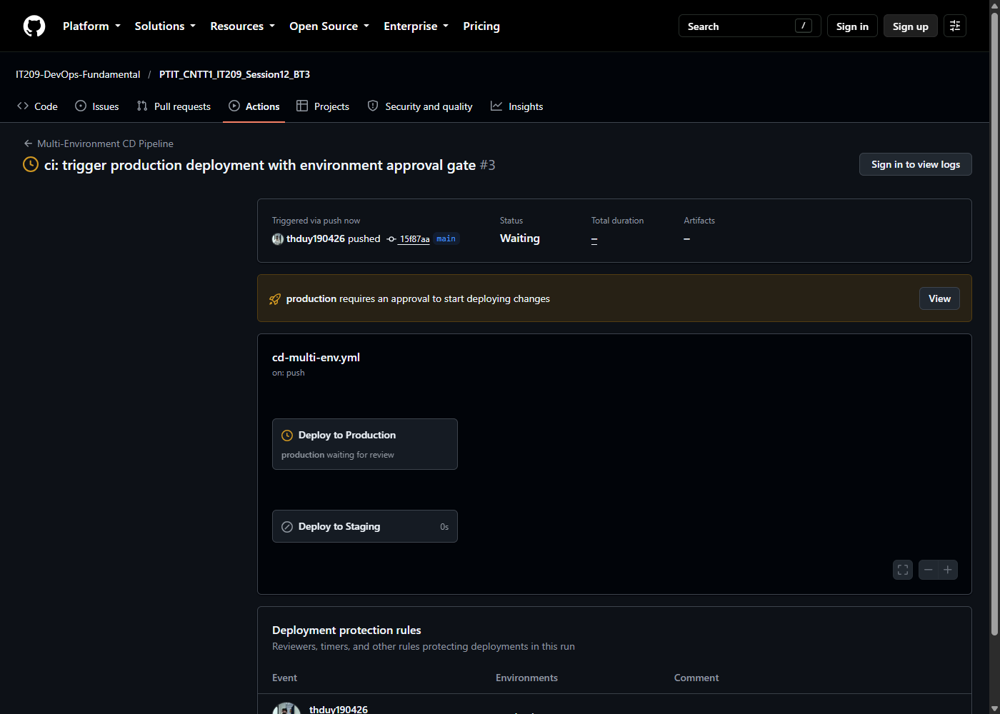
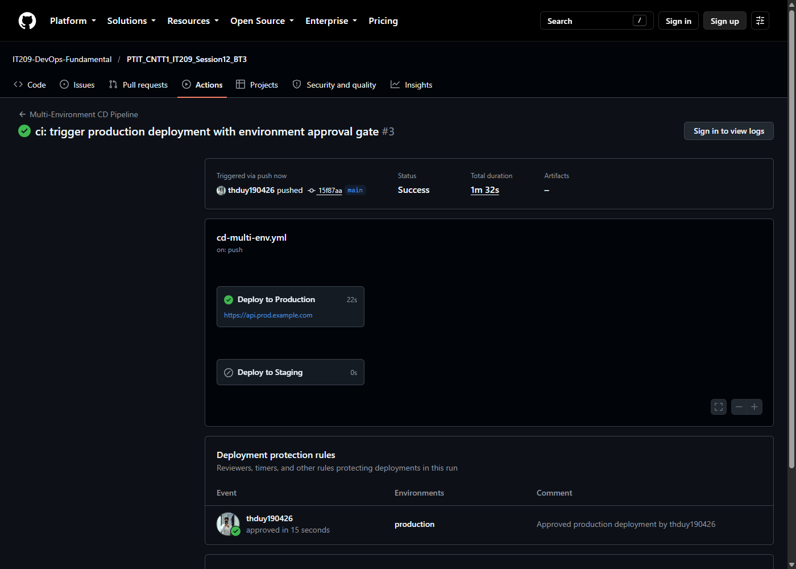
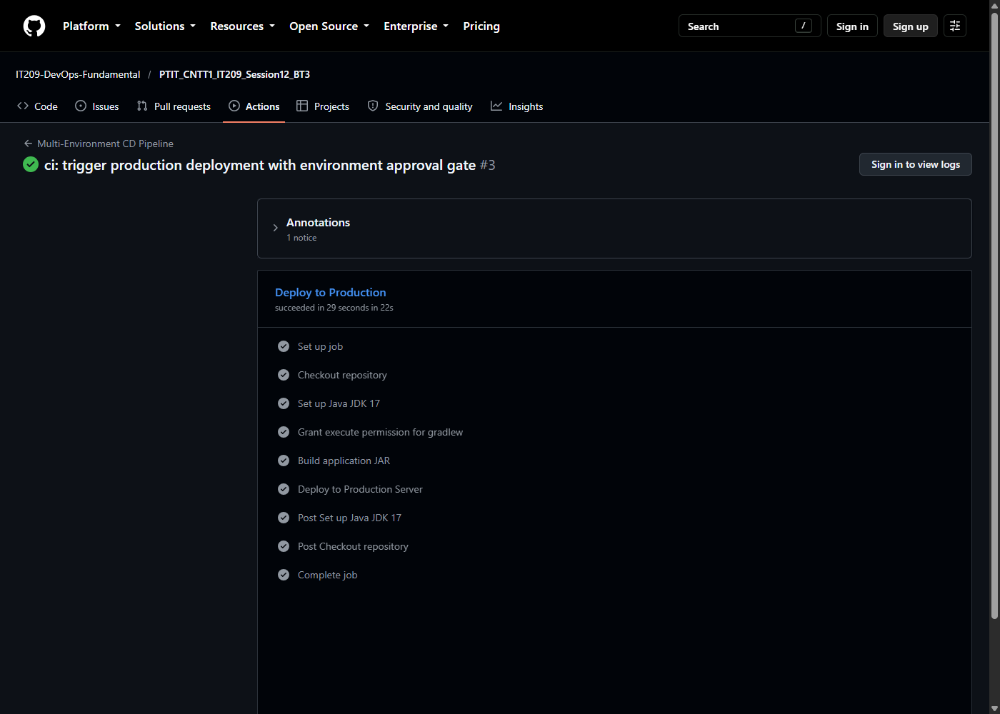
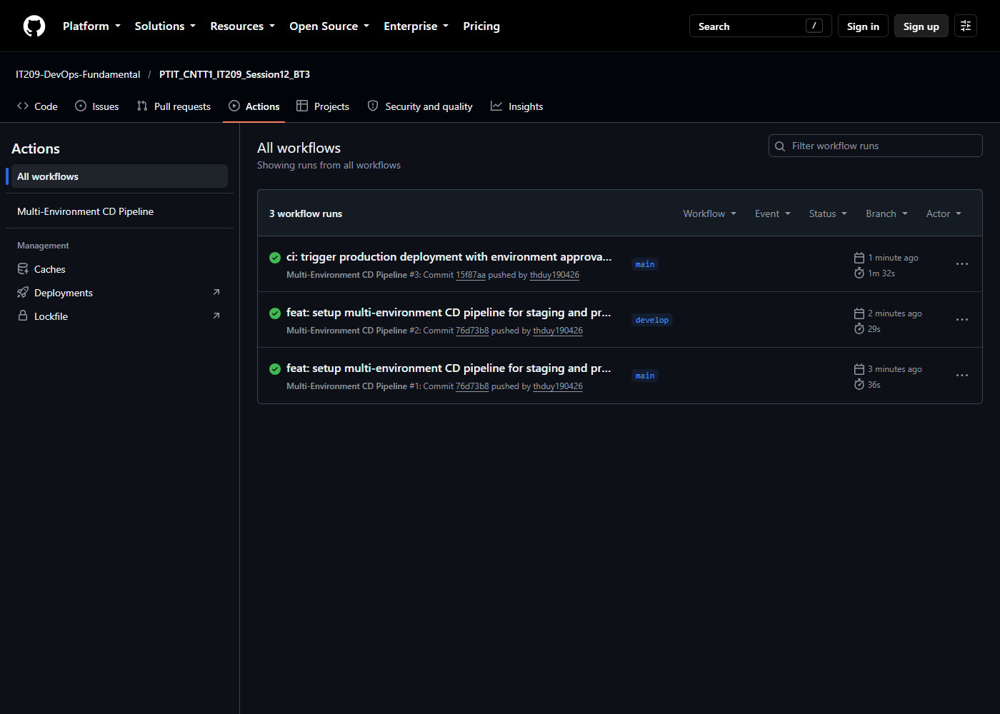

# Bài 3: Tách biệt luồng CI/CD đa môi trường (Staging & Production) với GitHub Environments

## 1. Mục tiêu
- Quản lý hạ tầng triển khai đa môi trường (**Staging** và **Production**) thông qua tính năng **GitHub Environments**.
- Cấu hình **Environment Protection Rules** yêu cầu phê duyệt thủ công (**Required reviewers**) trước khi kích hoạt quy trình deploy lên môi trường Production.
- Tách biệt logic deployment:
  - Nhánh `develop`: Tự động deploy lên môi trường `staging`.
  - Nhánh `main`: Triển khai lên môi trường `production`, dừng lại chờ phê duyệt thủ công.

## 2. Kịch bản GitHub Actions Workflow
Tệp kịch bản: [`.github/workflows/cd-multi-env.yml`](.github/workflows/cd-multi-env.yml)

```yaml
name: Multi-Environment CD Pipeline

on:
  push:
    branches:
      - main
      - develop

jobs:
  deploy-staging:
    name: Deploy to Staging
    if: github.ref == 'refs/heads/develop'
    runs-on: ubuntu-latest
    environment:
      name: staging
      url: https://api.staging.example.com

    steps:
      - name: Checkout repository
        uses: actions/checkout@v5

      - name: Set up Java JDK 17
        uses: actions/setup-java@v5
        with:
          java-version: '17'
          distribution: 'temurin'
          cache: 'gradle'

      - name: Grant execute permission for gradlew
        run: chmod +x gradlew

      - name: Build application JAR
        run: ./gradlew bootJar

      - name: Deploy to Staging Server
        run: |
          echo "Deploying application to Staging environment..."
          echo "Deployment URL: https://api.staging.example.com"
          echo "Deployed successfully to Staging!"

  deploy-prod:
    name: Deploy to Production
    if: github.ref == 'refs/heads/main'
    runs-on: ubuntu-latest
    environment:
      name: production
      url: https://api.prod.example.com

    steps:
      - name: Checkout repository
        uses: actions/checkout@v5

      - name: Set up Java JDK 17
        uses: actions/setup-java@v5
        with:
          java-version: '17'
          distribution: 'temurin'
          cache: 'gradle'

      - name: Grant execute permission for gradlew
        run: chmod +x gradlew

      - name: Build application JAR
        run: ./gradlew bootJar

      - name: Deploy to Production Server
        run: |
          echo "Deploying application to Production environment..."
          echo "Deployment URL: https://api.prod.example.com"
          echo "Deployed successfully to Production!"
```

## 3. Cấu hình GitHub Environments & Protection Rules
- **Staging Environment**:
  - Tên: `staging`
  - URL: `https://api.staging.example.com`
  - Luồng deploy: Tự động kích hoạt khi push vào nhánh `develop`.
- **Production Environment**:
  - Tên: `production`
  - URL: `https://api.prod.example.com`
  - Protection Rules: Bật **Required reviewers**, gán tài khoản reviewer: `@thduy190426`.
  - Luồng deploy: Tự động dừng tại cổng bảo vệ (Waiting for review) khi push vào nhánh `main`.

## 4. Kết quả kiểm tra trên GitHub Actions
- **Repository**: [IT209-DevOps-Fundamental/PTIT_CNTT1_IT209_Session12_BT3](https://github.com/IT209-DevOps-Fundamental/PTIT_CNTT1_IT209_Session12_BT3)
- **Workflow Run (Production Gate)**: [Run #3 (ID: 38553335135)](https://github.com/IT209-DevOps-Fundamental/PTIT_CNTT1_IT209_Session12_BT3/actions/runs/38553335135)
- **Tiến trình kiểm thử**:
  1. Khi push lên nhánh `main`, job `deploy-prod` dừng lại ở trạng thái **Waiting** và hiển thị yêu cầu: `production requires an approval to start deploying changes`.
  2. Người duyệt (`thduy190426`) phê duyệt (`Approved production deployment`).
  3. Job tiếp tục thực thi và hoàn tất thành công tích xanh (**Success** trong 22s).

### Ảnh chụp màn hình minh chứng:

#### 1. Cửa sổ chờ phê duyệt (Waiting for review) cho môi trường Production:


#### 2. Kết quả sau khi phê duyệt thành công (Approved & Deployed):


#### 3. Chi tiết các bước thực thi hoàn tất trong Job `Deploy to Production`:


#### 4. Tổng quan danh sách Workflow Runs đa môi trường trong tab Actions:

